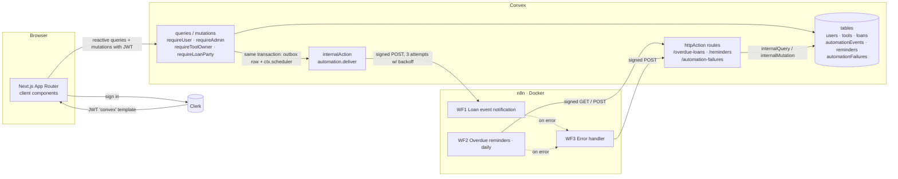
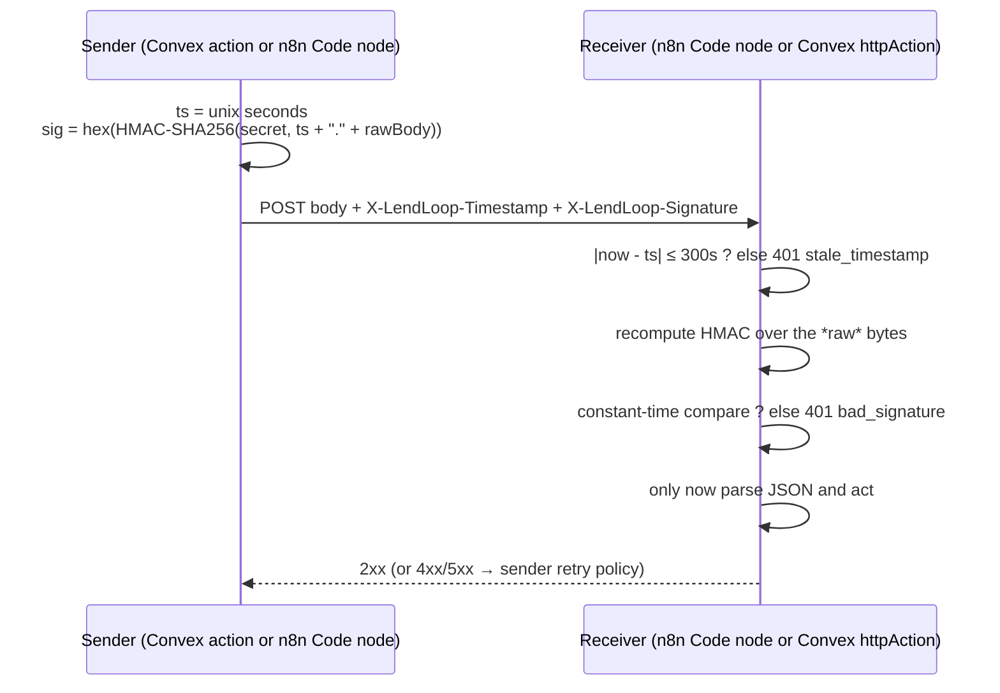

# LendLoop

> Borrow what you need. Lend what you don't.

LendLoop is a neighbourhood tool-lending app. Anyone can browse what's available; signed-in users list tools, request to borrow them for a date range, and lenders approve, decline and close loans. Notifications and overdue reminders run through **n8n**, connected to the app by an HMAC-signed, retried, idempotent integration.

**Stack:** Next.js 16 (App Router, TypeScript strict, Tailwind 4) · Clerk 7 · Convex 1.49 · n8n 2.46 (Docker)

- [Screenshots](#screenshots)
- [Local setup](#local-setup)
- [Environment variables](#environment-variables)
- [Architecture](#architecture)
- [Data model](#data-model)
- [Access control (RBAC)](#access-control-rbac)
- [Security and data minimization](#security-and-data-minimization)
- [Reliability design](#reliability-design)
- [Testing and CI](#testing-and-ci)
- [Known limitations](#known-limitations)
- [Production notes → PRODUCTION.md](PRODUCTION.md)

---

## Screenshots

Screenshots live in [`docs/screenshots/`](docs/screenshots/). Suggested captures: the public landing page (name + category only), the tool catalogue with availability and the Trusted Lender badge, incoming requests with automation activity, the Admin → Automation tab, and the n8n notification workflow.

---

## Local setup

Prerequisites: Node ≥ 22, Docker, a free [Clerk](https://clerk.com) account.

### 1. Install

```bash
git clone https://github.com/shivamg9/LendLoop.git && cd LendLoop
npm install
```

### 2. Clerk

1. Create a Clerk application (Email sign-in is enough).
2. **Configure → JWT templates → New template → Convex**. Keep the name **`convex`** (Convex validates `aud: "convex"`). Copy the **Issuer** URL.
   The template's claims must include `"aud": "convex"` plus `email`, `name` and `email_verified`. The Convex preset adds these; a blank template does not, and Convex then rejects the token with *"No auth provider found matching the given token"*.
3. **API Keys**: copy the publishable and secret keys into `.env.local` (see `.env.example`):

```bash
cp .env.example .env.local   # then fill NEXT_PUBLIC_CLERK_PUBLISHABLE_KEY and CLERK_SECRET_KEY
```

### 3. Convex

```bash
npx convex dev            # first run: log in (or choose a local anonymous deployment); writes CONVEX_* into .env.local
```

Keep it running. In a second terminal set the server-side env vars (these live in Convex, not in any file):

```bash
SECRET=$(openssl rand -hex 32)          # shared HMAC secret, reused for n8n below
npx convex env set CLERK_JWT_ISSUER_DOMAIN https://<your-app>.clerk.accounts.dev
npx convex env set ADMIN_EMAILS you@example.com
npx convex env set LENDLOOP_WEBHOOK_SECRET "$SECRET"
npx convex env set N8N_WEBHOOK_URL http://localhost:5678/webhook/lendloop-loan-events
```

> `N8N_WEBHOOK_URL` must be reachable *from Convex*. With a local Convex backend, `localhost:5678` works. With a cloud deployment, expose n8n through a tunnel (`cloudflared tunnel --url http://localhost:5678` or `ngrok http 5678`) and use that HTTPS URL.

### 4. n8n

```bash
cd n8n
cp .env.example .env
# LENDLOOP_WEBHOOK_SECRET = the same $SECRET as above
# CONVEX_SITE_URL         = http://host.docker.internal:3211 (local Convex) or https://<deployment>.convex.site
# N8N_ENCRYPTION_KEY      = openssl rand -hex 24
docker compose up -d
```

### 5. Import and publish the workflows

```bash
docker compose exec n8n n8n import:workflow --separate --input=/workflows
docker compose exec n8n n8n publish:workflow --id=lendloopNotifyW1
docker compose exec n8n n8n publish:workflow --id=lendloopRemindW1
docker compose exec n8n n8n publish:workflow --id=lendloopErrorW01   # error workflows must be published too
docker compose restart n8n
cd ..
```

Open http://localhost:5678 to create the n8n owner account and inspect executions. The workflow IDs are fixed in the JSON so the `errorWorkflow` links survive import.

### 6. Run the app

```bash
npm run dev     # http://localhost:3000
```

### 7. Make yourself admin

Sign in with an email listed in `ADMIN_EMAILS`. On the **first** sync, a **verified** email on that list gets `role: "admin"` and an **Admin** link appears. If you signed in before adding your email, delete your row in the Convex dashboard (`users` table) and sign in again. There is deliberately no API to change roles.

### 8. Demo data (optional)

```bash
npx convex env set ALLOW_SEED true
npx convex run seed:run       # 3 users, 5 tools, 4 loans incl. one overdue
```

Trigger the overdue workflow without waiting for 09:00 UTC by opening it in n8n and clicking **Execute workflow** (it has a *Run now (manual)* trigger).

---

## Environment variables

| Variable | Where | Purpose |
|---|---|---|
| `NEXT_PUBLIC_CLERK_PUBLISHABLE_KEY` | `.env.local` | Clerk frontend key |
| `CLERK_SECRET_KEY` | `.env.local` | Clerk backend key (used by `proxy.ts`) |
| `NEXT_PUBLIC_CONVEX_URL`, `CONVEX_DEPLOYMENT` | `.env.local` | Written by `npx convex dev` |
| `CLERK_JWT_ISSUER_DOMAIN` | Convex env | Issuer of the Clerk `convex` JWT template (`convex/auth.config.ts`) |
| `ADMIN_EMAILS` | Convex env | Comma-separated admin bootstrap list |
| `LENDLOOP_WEBHOOK_SECRET` | Convex env **and** `n8n/.env` | Shared HMAC secret, both directions |
| `N8N_WEBHOOK_URL` | Convex env | n8n production webhook URL for loan events |
| `ALLOW_SEED` | Convex env | `true` only on dev deployments; gates `seed:run` |
| `CONVEX_SITE_URL` | `n8n/.env` | Base URL of Convex HTTP actions as seen from the container |
| `N8N_ENCRYPTION_KEY` | `n8n/.env` | Encrypts n8n's credential store |

`.env.local` and `n8n/.env` are gitignored; `.env.example` and `n8n/.env.example` are the templates.

---

## Architecture



### Signed request flow (both directions)



- **Convex → n8n:** `convex/automation.ts` signs with Web Crypto. WF1's Webhook node has *Raw Body* on, and the *Verify signature* Code node verifies the exact bytes with `crypto.timingSafeEqual`.
- **n8n → Convex:** Code nodes sign; `convex/lib/signedHttp.ts` wraps every route and verifies with `crypto.subtle` plus a constant-time compare (`convex/lib/hmac.ts`) **before** parsing JSON. Bodies above 16 KB are rejected.
- GET requests sign an empty body. Because the timestamp is inside the MAC, a captured request can't be replayed with a fresh timestamp.

### The n8n workflows

| Workflow | Shape |
|---|---|
| **1 – Loan event notification** | Webhook (raw body, respond via node) → Verify signature → IF valid → Build notification → **Send notification (mock)** → Respond 200 · invalid → Respond 401 |
| **2 – Overdue reminders** | Schedule (daily 09:00 UTC) / Run now → Sign GET → GET `/overdue-loans` (retry) → one item per loan → Loop over loans → Build reminder → **Send reminder (mock)** → Sign write-back → POST `/reminders` (retry) → back to loop |
| **3 – Error handler** | Error Trigger → Build signed failure report → POST `/automation-failures` (retry) |

The mock senders are Set nodes that write `{channel, to, subject, text, sentAt}` into the execution data. The upstream *Build …* nodes already produce a channel-agnostic `to / subject / text`, so swapping in Gmail, SMTP, Resend or Slack means replacing that one node and mapping three fields.

### Code layout

```
app/                       routes: / · /tools · /my/{listings,requests,incoming} · /admin
components/{ui,layout,tools,loans,admin}
convex/
  schema.ts  auth.config.ts  http.ts
  users.ts tools.ts loans.ts admin.ts        public API, each guarded by lib/auth
  automation.ts automationInternal.ts       outbox delivery (internal only)
  automationHttp.ts                         internal fns behind http.ts
  seed.ts                                   dev-only internal mutation
  lib/  auth · hmac · signedHttp · outbox · retry · loanRules · loanStore · dates · ...
n8n/  docker-compose.yml  workflows/*.json
tests/  hmac · rules (pure)  ·  access · http (convex-test)
```

---

## Data model

| Table | Key fields | Indexes |
|---|---|---|
| `users` | `clerkId`, `email`, `name`, `role: admin\|user`, `trustedLender` | `by_clerkId`, `by_email` |
| `tools` | `ownerId`, `name` (2–80), `category`, `condition`, `description` (≤500) | `by_owner`, `by_category` |
| `loans` | `toolId`, `lenderId`, `borrowerId`, `startDate`, `endDate` (ISO `YYYY-MM-DD`), `status`, `decidedAt?`, `returnedAt?` | `by_tool_status`, `by_borrower`, `by_lender`, `by_status_endDate` |
| `automationEvents` | outbox: `eventType`, `loanId`, minimized `payload`, `status: pending\|sent\|failed`, `attempts`, `lastError?`, `sentAt?` | `by_loan`, `by_status` |
| `reminders` | `idempotencyKey = loanId:YYYY-MM-DD`, `loanId`, `status`, `sentAt` | `by_key`, `by_loan` |
| `automationFailures` | `workflowName`, `nodeName?`, `message` (≤1000), `executionId?` | — |

**Loan lifecycle:** `pending → approved | declined | cancelled`, `approved → returned`. All transitions go through one guarded helper (`convex/lib/loanStore.ts#transition`) driven by a transition table. **Overdue** is derived (`approved && endDate < today`), not stored, so it can't drift.

Dates are calendar strings compared lexicographically. "Today" is the server's UTC date, so the client and server always agree.

---

## Access control (RBAC)

Identity is **always** taken from `ctx.auth` (the Clerk JWT that Convex verifies). No function accepts a user id from the client. Every public function starts with one of the helpers in `convex/lib/auth.ts`.

| Action | Anonymous | User | Tool owner / lender | Borrower | Admin |
|---|:-:|:-:|:-:|:-:|:-:|
| See public list (name + category) | ✅ | ✅ | ✅ | ✅ | ✅ |
| See catalogue, availability, owner name | ❌ | ✅ | ✅ | ✅ | ✅ |
| List a tool | ❌ | ✅ | — | — | ✅ |
| Edit / delete a listing | ❌ | ❌ | ✅ own | ❌ | remove any |
| Request to borrow | ❌ | ✅ not own tool | ❌ own tool | — | ✅ not own tool |
| Approve / decline request | ❌ | ❌ | ✅ | ❌ | ❌ ¹ |
| Cancel pending request | ❌ | ❌ | ❌ | ✅ | ❌ ¹ |
| Mark returned | ❌ | ❌ | ✅ | ❌ | ❌ ¹ |
| View all loans, users, automation health | ❌ | ❌ | ❌ | ❌ | ✅ |
| Toggle Trusted Lender | ❌ | ❌ | ❌ | ❌ | ✅ |
| Change any role | ❌ | ❌ | ❌ | ❌ | ❌ ² |
| Call `internal*` functions (n8n-facing, seed, delivery) | ❌ | ❌ | ❌ | ❌ | ❌ ³ |

¹ Admins moderate; they don't act on someone else's loan. ² Roles come only from `ADMIN_EMAILS` on first sync. ³ Reachable only through the scheduler, signed HTTP routes or the Convex CLI/dashboard.

| Helper | Guarantees |
|---|---|
| `requireUser` | valid JWT **and** a synced `users` row |
| `requireAdmin` | `requireUser` + `role === "admin"` |
| `requireToolOwner(toolId)` | tool exists and `ownerId === me` |
| `requireLoanParty(loanId, "lender" \| "borrower")` | loan exists and I am that party |

---

## Security and data minimization

| Decision | Why |
|---|---|
| `tools.listPublic` returns `{_id, name, category}` only | Hiding owner data in the UI isn't enough: anything a query returns is visible on the wire. Covered by a test that asserts the exact key set. |
| Signed-in views expose counterpart **name + trust badge**, never email | Users need to know who they're dealing with, not how to contact them outside the platform. |
| `users.syncMe` takes **no args** | The client can't choose its id, email or role. |
| Admin bootstrap requires `emailVerified` | Otherwise anyone could sign up with an unverified admin address. |
| Role set only on first insert | A later change to `ADMIN_EMAILS` can't silently elevate or demote, and there's no role-changing API to attack. |
| `v.*` validators on every arg + explicit length limits (`assertLength`) | Convex validates types; we add semantic limits and trim whitespace. |
| Errors are `ConvexError({code, message})` | The UI shows precise messages without leaking stack traces. |
| Outbound payload = `eventId, eventType, loanId, toolName, recipient email + first name, status, dates` | n8n only needs to address and word a message. No descriptions, no other user, no surname. |
| `/overdue-loans` returns `loanId, borrower first name + email, toolName, endDate` | Same principle for the inbound pull. |
| Failure reports carry message, node, workflow, execution id: **no stack, no input data**, truncated | Error payloads are a classic PII leak. |
| Verify signature **before** parsing; 16 KB body cap; 5-minute symmetric window; constant-time compare | Prevents parser abuse, replay and timing oracles. |
| Webhook 401 bodies return a reason code (`stale_timestamp`, `bad_signature`) | Helps operators debug; reveals nothing about the secret. |
| `internal*` functions for everything n8n triggers | They aren't part of the public API surface at all. |
| n8n bound to `127.0.0.1`, only named env vars passed in compose | The editor is never exposed, and the container sees only the three variables it needs. |
| Exported workflows contain no secrets; `scripts/scan-workflows.sh` runs in CI | Secrets are referenced as `$env.*` and scanned for credentials blocks, 64-hex strings, Clerk keys and emails. |
| `proxy.ts` uses plain `clerkMiddleware()` | Following Clerk 7's resource-based guidance (`createRouteMatcher` is deprecated): authorization lives in Convex, the source of truth, rather than in path matching that can drift. |

### n8n secrets trade-off

The Code nodes read `LENDLOOP_WEBHOOK_SECRET` via `$env`, which requires:

- `N8N_BLOCK_ENV_ACCESS_IN_NODE=false`: lets **any** workflow on this instance read **any** env var of the container. That's acceptable here because the instance is single-tenant, only the variables listed in `docker-compose.yml` reach it, and the editor is loopback-only. On a shared n8n you would instead store the secret as an n8n credential (for example a *Crypto* node or a custom credential type), or sign through a small sidecar, and keep env access blocked.
- `NODE_FUNCTION_ALLOW_BUILTIN=crypto`: allows `require('crypto')` for HMAC and `timingSafeEqual`. Only `crypto` is allow-listed, not `*`.

---

## Reliability design

**Transactional outbox.** A loan mutation writes the state change, an `automationEvents` row and a `ctx.scheduler.runAfter(0, internal.automation.deliver)` call **in the same transaction**. If the mutation fails, none of them exist; if it commits, delivery is guaranteed to be attempted. Notifications can't describe changes that never happened and can't be lost to a crash between the write and the send. `transition()` emits the event, so no code path can change status without notifying.

**Retries with backoff.** `deliver` makes one attempt per run with a 10 s timeout, then calls `recordAttempt`, which atomically increments `attempts`, stores `lastError` and schedules the next run (2 s, then 8 s), up to 3 attempts. `4xx` (except `408`/`429`) fails fast, because a bad signature won't fix itself. Network errors and `5xx` retry. Exhausted events become `failed` and show in **Admin → Automation**. Verified by stopping n8n: the event reached `attempts: 3, status: failed`.

**Idempotency.**
- *Outbound:* `eventId` is the outbox row id, stable across retries, so a receiver can deduplicate. The action also re-reads the row and exits if it's no longer `pending`.
- *Write-back:* Convex builds the key `${loanId}:${YYYY-MM-DD}` **server-side** (n8n can't choose it) and looks it up on the `by_key` index. A repeat POST returns `200 {created:false, reminder}` with the existing row; the first returns `201`. Convex mutations are serializable, so two concurrent POSTs can't both insert.

**Concurrency on approvals.** `approve` re-checks overlapping approved loans inside the mutation. Convex's serializable transactions make the check and the patch atomic, so two overlapping approvals can't both succeed. Conflicting pending requests are auto-declined in the same transaction, and each one emits its own notification.

**n8n side.** HTTP nodes use *Retry On Fail* (3 tries, 3 s apart; signatures stay valid within the 5-minute window). Workflows 1 and 2 set **Error Handler** as their `errorWorkflow`, which posts a signed failure record. The admin sees failures from both directions in one place.

**Activity on loan cards.** Each loan shows its latest automation activity, merged from outbox events and reminders, e.g. "Approval notification sent 2 hours ago" or "Overdue reminder sent 2 days ago". Failures show in red, and error details stay admin-only.

---

## Testing and CI

```bash
npm run check          # next typegen + tsc, eslint, vitest
npm run scan:workflows # secret scan of n8n/workflows
```

- `tests/hmac.test.ts`: RFC 4231 vector, round trip, tampered body, wrong secret, stale/future timestamps, window edge, malformed headers, replay with a fresh timestamp.
- `tests/rules.test.ts`: date validation (30-day cap, past start, invalid calendar dates), inclusive overlap, overdue, transition table, retry policy, admin email parsing.
- `tests/access.test.ts` (**convex-test**, real functions with fake identities): admin bootstrap and the unverified-email case, anonymous rejection, owner-only edit/delete, length limits, the public query's exact key set, no email leak, cannot borrow own tool, lender-only approve, auto-decline of conflicts, borrower-only cancel, lender-only return, outbox payload shape, admin-only functions.
- `tests/http.test.ts`: unsigned/tampered → 401, minimal `/overdue-loans` shape, reminder idempotency (201 then 200, one row), failure-report validation.

`.github/workflows/ci.yml` runs typecheck, lint, tests and the secret scan on every push and PR.

---

## Known limitations

- **Mock delivery.** Notifications and reminders are written to n8n execution data, not sent.
- **No receiver-side dedupe in WF1.** `eventId` is provided, but the mock doesn't store seen ids. A real sender should (for example a Redis/Postgres key or n8n's *Remove Duplicates* node), because a timeout after n8n processed a request triggers a retry.
- **UTC dates.** "Today" is UTC, so a user near midnight in a far-off timezone may see a one-day difference. The UI says "Dates are in UTC".
- **Unpaginated lists.** User-facing lists are unpaginated (admin and public lists are capped at 200). Fine for a neighbourhood; use `.paginate()` at scale.
- **Reminder cadence.** One reminder per loan per UTC day by design. There's no escalation or opt-out.
- **Role changes need the dashboard.** Changing an existing user's role requires the Convex dashboard. This is deliberate (no role API), but there's no admin UI for it.
- **Admin removal of an active loan.** It's refused until the lender marks the loan returned. An admin "force-close" flow isn't implemented.
- **No owner dedupe across accounts.** The same person with two Clerk accounts is two users.
